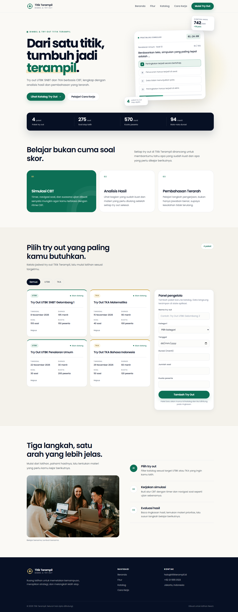

# Titik Terampil

Landing page dan katalog try out UTBK SNBT & TKA berbasis React. Proyek ini dibuat untuk Tugas Bab 6 React dengan fokus pada pengelolaan data try out di sisi klien.



## Fitur

- Landing page responsif dengan navigasi mobile.
- Katalog berisi empat paket try out awal untuk UTBK dan TKA.
- Filter kategori: Semua, UTBK, dan TKA.
- Form controlled untuk menambah try out baru, lengkap dengan validasi.
- Statistik katalog dihitung otomatis dari data try out.
- Hapus try out dengan dialog konfirmasi.
- Empty state kontekstual, termasuk teks `Belum ada data try out`.
- Font Poppins self-hosted dan foto lokal tanpa CDN.

## Stack

- React 19 + Vite 8
- CSS murni, tanpa framework UI
- Oxlint
- Tanpa dependency tambahan

## Menjalankan

```bash
npm install
npm run dev
```

Buka `http://localhost:5173`.

Perintah verifikasi:

```bash
npm run lint
npm run build
npm run preview
```

## Struktur

```text
src/
  App.jsx
  App.css
  index.css
  main.jsx
  components/
    Brand.jsx
    Navbar.jsx
    Hero.jsx
    StatsSummary.jsx
    FeatureGrid.jsx
    TryOutCatalog.jsx
    TryOutCard.jsx
    TryOutForm.jsx
    EmptyState.jsx
    HowItWorks.jsx
    Footer.jsx
  data/
    tryOutData.js
public/
  fonts/
  images/
  favicon.svg
docs/
  screenshots/
```

## State dan Alur Data

- `App.jsx` menyimpan `daftarTryOut` dan `kategoriAktif`.
- `filterTryOut` menurunkan daftar yang tampil berdasarkan kategori aktif.
- `tambahTryOut` membuat id baru dengan `crypto.randomUUID()`, menambahkan data ke awal daftar, lalu mereset filter ke `Semua`.
- `hapusTryOut` meminta konfirmasi, lalu menghapus data berdasarkan id.
- `TryOutForm` mengelola nilai form secara controlled dan memvalidasi seluruh field sebelum mengirim data.
- `StatsSummary` menghitung jumlah paket, soal, kuota, dan rata-rata durasi dari data aktual.
- Data hanya hidup di state browser. Reload halaman akan mengembalikan data awal.

## Pemetaan Ketentuan Tugas

| Ketentuan | Implementasi |
| --- | --- |
| Minimal lima komponen | 11 komponen di `src/components/` |
| Entity data | `Try Out` dengan nama, kategori, tanggal, durasi, jumlah soal, dan kuota |
| State array di `App.jsx` | `const [daftarTryOut, setDaftarTryOut] = useState(dataAwalTryOut)` |
| `.map()` dengan key unik | Kartu memakai `key={tryOut.id}`; data statis memakai key stabil |
| Form controlled | `TryOutForm` memakai `value` dan `onChange` untuk setiap field |
| Empty state | `EmptyState` menampilkan `Belum ada data try out` saat katalog kosong |
| Repo GitHub + screenshot | Dokumentasi dan tangkapan layar tersedia di repo ini |

## Screenshot

- [Beranda desktop](docs/screenshots/01-beranda-desktop.png)
- [Katalog desktop](docs/screenshots/02-katalog-desktop.png)
- [Katalog kosong](docs/screenshots/03-katalog-kosong.png)
- [Halaman mobile](docs/screenshots/04-halaman-mobile.png)
- [Setup awal](docs/screenshots/00-setup-awal.png)

## Catatan

- Detail kontak di `Footer.jsx` masih berupa placeholder.
- Foto latar di section cara kerja berasal dari Unsplash.
- Poppins diambil dari Google Fonts dengan lisensi SIL Open Font License.
